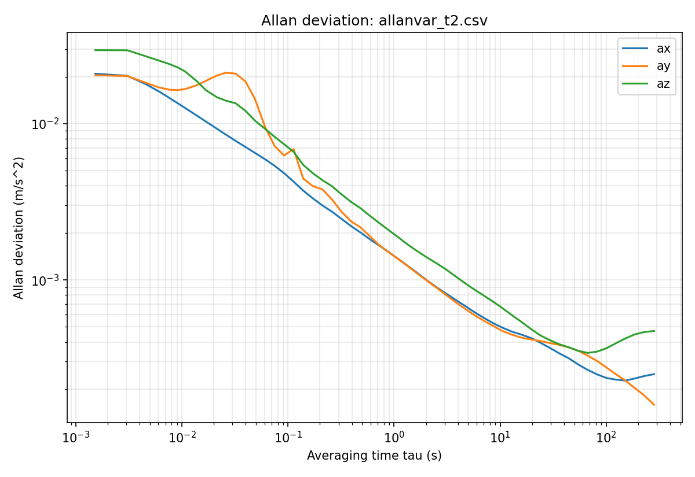

# Vibration-Based Fan Fault Detection

MAE 311 Group 7, Fall 2026

The objective of this project is to design a device that makes a measurement(s) utilizing the data aquisition capability
of an Arduino Programmable Logic Controller (PLC). In our project, an Arduino and an MPU-6050 accelerometer measure a 
small fan's vibration, and a random forest model classifies it as healthy or faulty (imbalance from tape or added weight
on a blade). When the accelerometer was first recieved, static and dynamic tests were ran to ensure that the
accelerometer was properly recording values. The static calibration test were ran by recording the acceleration on the 
6 different axes. The sensor was "mounted" to a book with a rubber band to keeping the sensor level during each trial.
Prior to recording data to train the random forest model, the accelerometer needs to be calibrated. 

## How it works
1. **Record:** an Arduino sketch streams raw accelerometer counts; a Python script saves them to CSV.
2. **Calibrate:** a six-position test gives the scale/misalignment matrix S and bias B; an Allan test gives the noise.
3. **Features:** each recording is cut into 1 s windows; features include RMS, kurtosis, crest factor and the
   amplitude at 1x-4x the fan's rotation frequency.
4. **Classify:** a random forest outputs healthy/faulty with a confidence.

## Hardware
- Arduino Uno, Adafruit MPU-6050 (#3886), I2C, range +/-4 g, 184 Hz filter
- Two identical fans (A: healthy reference, B: used for the fault tests)

## Files
| File | Purpose |
|---|---|
| `MPU6050_fast_logger.ino` | Arduino sketch (500000 baud, about 650-800 Hz sampling) |
| `newlogger.py` | Saves the serial stream to a CSV |
| `IMU_calibration.py` | Six-position calibration and Allan variance |
| `imu_calibration.json` | Saved S, B and their standard errors |
| `model_pipeline.py` | Loading, windowing, features, training |
| `test_model.py` | Scores held-out recordings |
| `demo.py` | Interactive demo: result + confidence for any CSV |

## Setup
```
pip install numpy pandas scipy scikit-learn joblib matplotlib pyserial
```

## Usage
```
python IMU_calibration.py calibrate            # six-position data in calibration_data/
python IMU_calibration.py allan --file <csv>   # long stationary recording
python model_pipeline.py                       # trains and saves fault_model.joblib
python test_model.py                           # held-out test set (model_test_data/)
python demo.py                                 # type a CSV name, or: summary, calibration, noise, exit
```
Recording names follow `<fan>_<speed>_<condition>_t<trial>.csv`, e.g. `B_low_2tape_t3.csv`
(conditions: healthy, 1tape, 2tape, batt).

## Results
- Calibration (six-position teset), +/- one standard error: 
```
x: bias +0.4124 +/- 0.0066 m/s^2,   scale 1.00296 +/- 0.00004
y: bias -0.0493 +/- 0.0068 m/s^2,   scale 0.99424 +/- 0.00004
z: bias -1.7672 +/- 0.0051 m/s^2,   scale 1.01778 +/- 0.00017
```
- Noise (Allan):
```
axis    white noise N       density     bias instability
        m/s/sqrt(s)   (m/s^2)/sqrt(Hz)       m/s^2
x       0.00140             0.00197          0.00034
y       0.00182             0.00257          not reached
z       0.00208             0.00294          0.00051
```

- ## Results

### Held-out test (recordings the model never trained on)
Recorded in a separate session after remounting the sensor. 

| Group | Recordings correct |
|---|--------------------|
| Healthy, fan B | 4 / 4              |
| Healthy, fan A (never faulty in training) | 2 / 2              |
| 1 wrap | 2 / 2              |
| 2 wraps | 2 / 2              |
| **Overall** | **10 / 10**        |

Confusion matrix (rows = true healthy / faulty, columns = predicted):

|  | Predicted healthy | Predicted faulty |
|---|----|------------------|
| **True healthy** | 6  | 0                |
| **True faulty** | 0  | 4                |

## Limitations
- Trained on two fans at low speed, with tape and a battery as the faults.
- The confidence is the forest's vote share, not a calibrated probability.

## Team
Graham Barrett, Gavin Chambers, Jacob Connelly, Walker Latham, Dang Le